# FinSight: 딥러닝 기반 주가 예측 서비스

> 종목마다 가장 잘 맞는 모델·데이터셋·기간 조합을 찾아 예측하고, 웹과 텔레그램 봇으로 제공하는 서비스

| 항목 | 내용 |
|---|---|
| 기간 | 2024.07 – 2024.08 |
| 과정 | 아시아경제 「빅데이터 기반 비즈니스 모델 맞춤형 AI솔루션 개발」 |
| 팀 | 3인 팀 · **정영균(팀장)**, 백승주, 박영진 |
| 기술 | Python, TensorFlow(Keras), XGBoost, scikit-learn, yfinance, FRED API, Streamlit, Telegram Bot |

<br>

## 문제
종목마다 가격을 움직이는 요인이 달라서, 하나의 모델로 모든 종목을 예측하기는 어렵다고 봤습니다. 종목별로 가장 잘 맞는 모델과 데이터 조합을 찾아 예측하는 것을 목표로 했습니다.

## 내 역할 (팀장)
- 프로젝트를 이끌며 모델 구현을 기획하고 직접 구현
- 기술지표(RSI, MACD, 볼린저밴드, 거래량)와 외부지표(금리, 달러 인덱스, 장단기 금리차)로 데이터셋 3종 구성
- LSTM·GRU·Transformer·XGBoost × 데이터셋 3종 × 기간 2종을 RMSE로 비교
- 매주 다음 주 예측을 자동 전송하는 텔레그램 봇 구현

## 접근
1. **데이터 수집**: yfinance로 주가와 기술지표, FRED API로 거시 지표 수집
2. **데이터셋 구성**: 기술지표 / 외부지표 / 둘을 합친 데이터셋 3종
3. **모델 비교**: LSTM, GRU, Transformer, XGBoost를 같은 데이터·기간·지표(RMSE)로 비교하고, GRU는 하이퍼파라미터(층, 유닛, 드롭아웃, 배치, 에폭)를 튜닝
4. **서비스**: 종목별 최적 조합을 저장해 Streamlit 웹과 텔레그램 봇으로 제공

## 결과
- 대상 4개 종목(AAPL, KO, JNJ, JPM)에서 **GRU + 5년 데이터** 조합이 가장 좋은 성능
- 종목에 따라 최적 데이터셋이 달랐음 (JPM은 금리 등 외부지표를 포함한 데이터셋)
- 예측 결과를 Streamlit 웹과 텔레그램 봇(매주 일요일 다음 주 예측 전송)으로 제공

## 배운 점
복잡한 모델이 항상 더 좋은 결과를 내지는 않았습니다. 같은 데이터와 지표로 여러 조합을 나란히 비교해야 차이가 어디서 오는지 판단할 수 있다는 것을 배웠습니다.

## 폴더 구조
```text
FinSight
├── 데이터셋/               # 수집 코드, 업종별 주가·기술지표, 외부지표, 예측 결과
├── GRU_하이퍼파라미터튜닝/  # 층·유닛·드롭아웃·배치·에폭 튜닝 결과
├── 모델/                   # 기획서
├── 서비스(챗봇,웹)/         # Streamlit 웹(p2.py), 텔레그램 봇(Bot.py), 시연 영상
└── Doc/                    # 발표 자료
```

## AI 활용
- ChatGPT로 코드 작성과 오류 수정

<br>

<details>
<summary><b>발표 자료 보기 (34장)</b></summary>
<br>

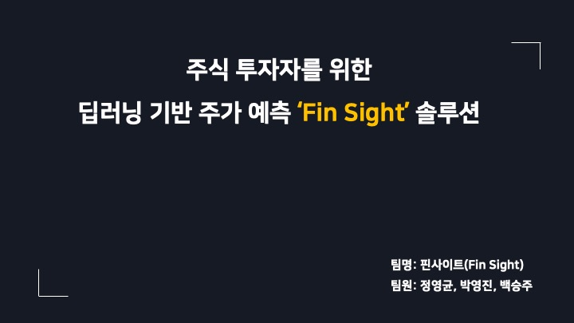
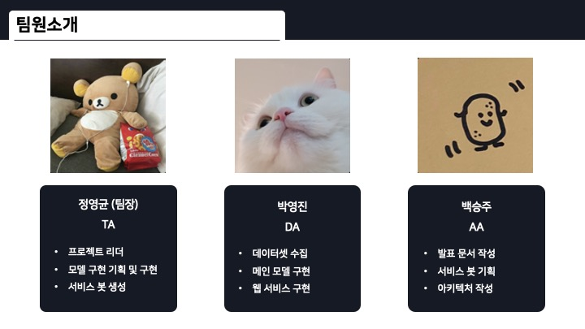
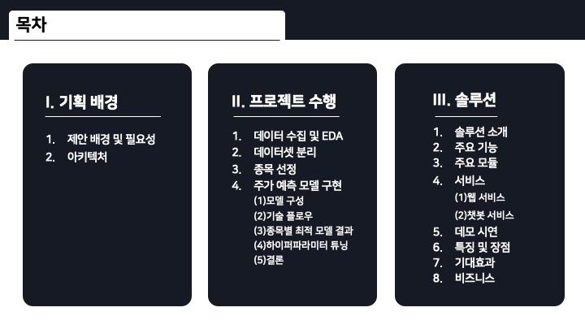
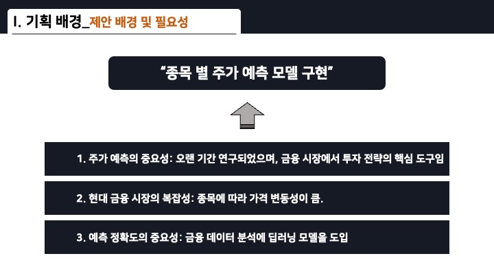
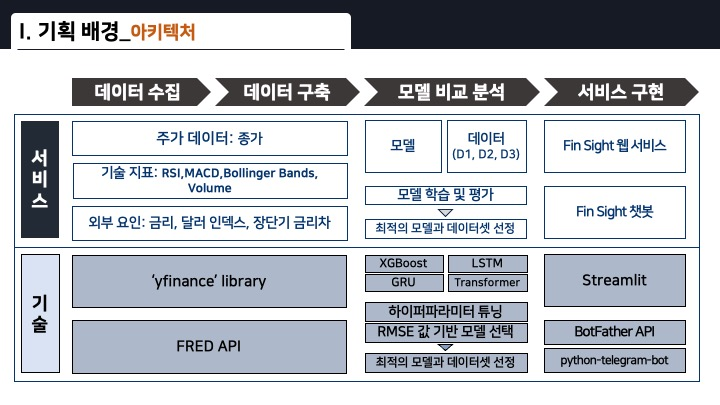
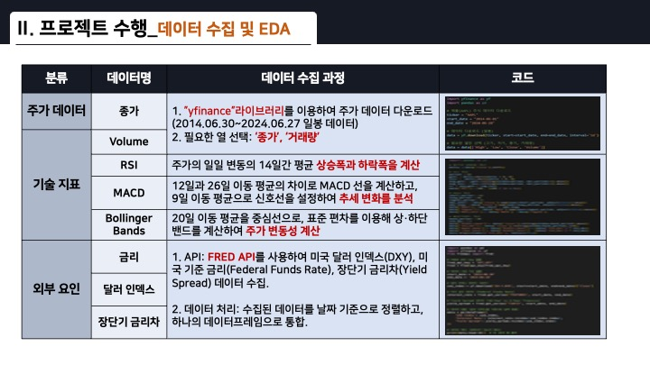
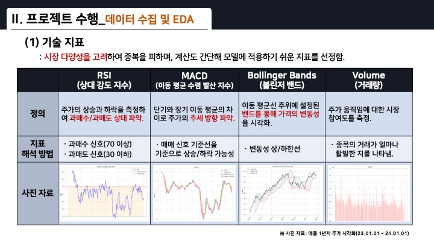
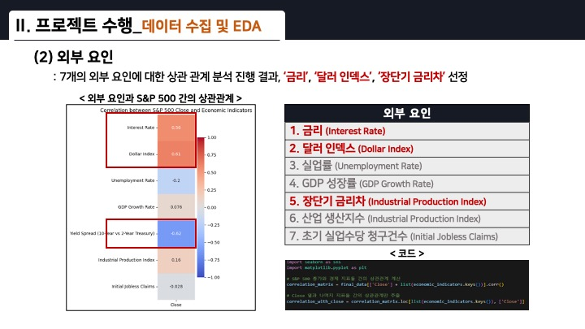


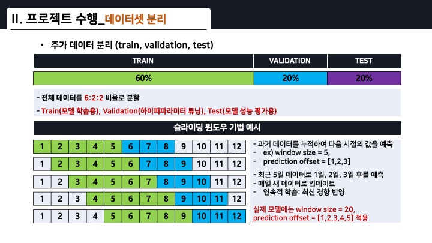
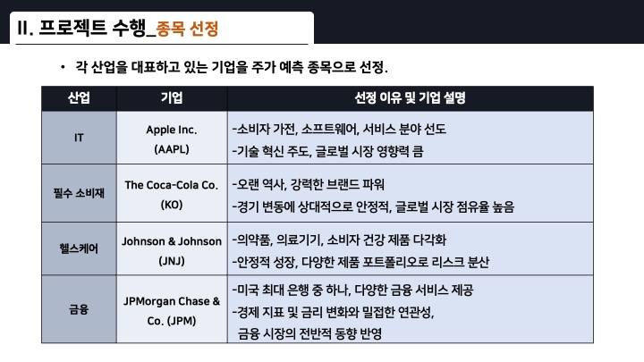
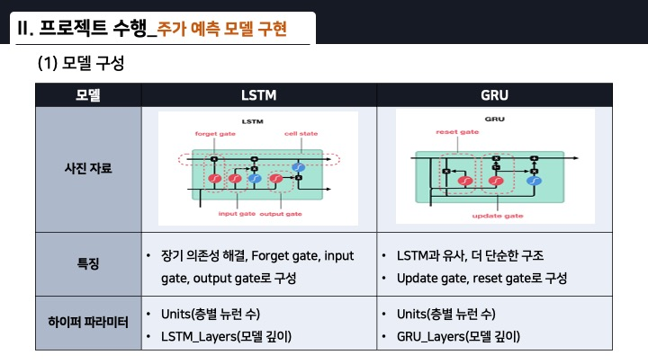


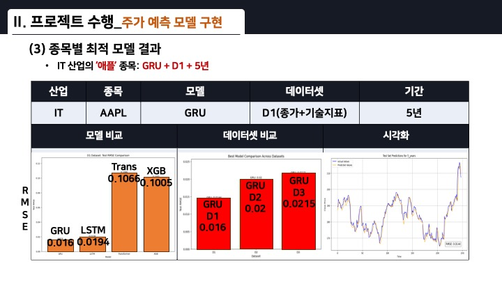

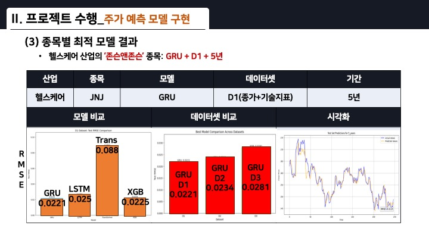

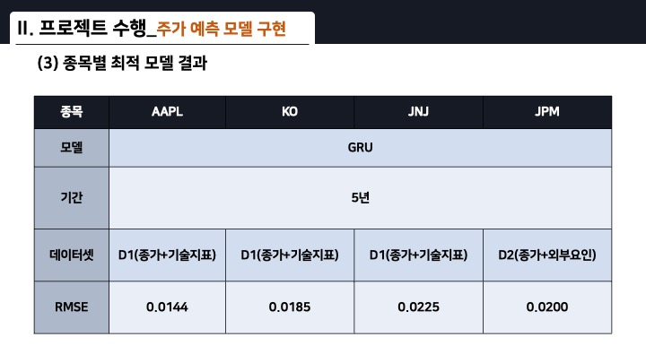
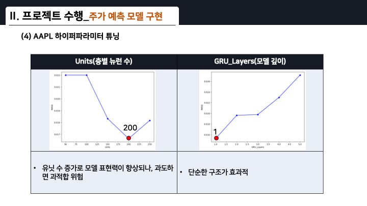


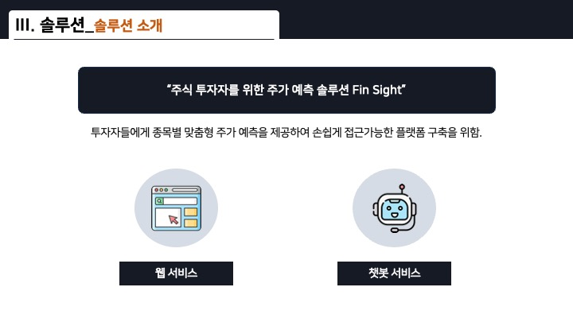
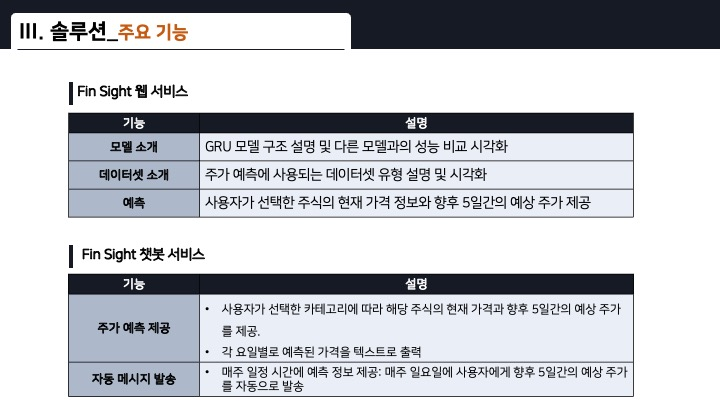
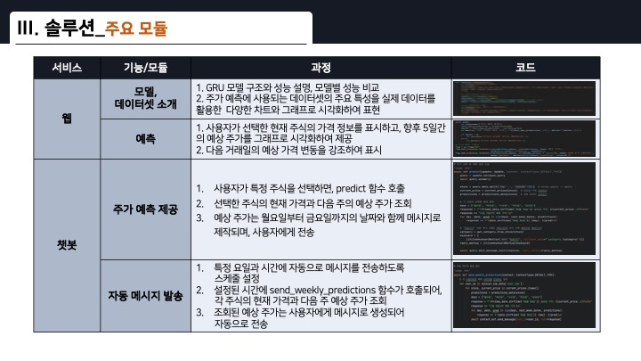

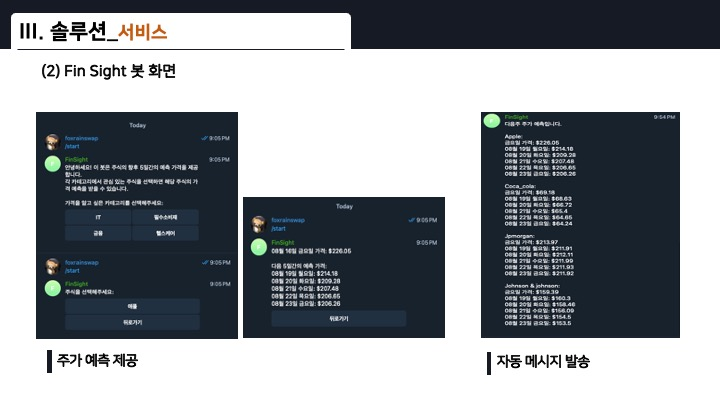
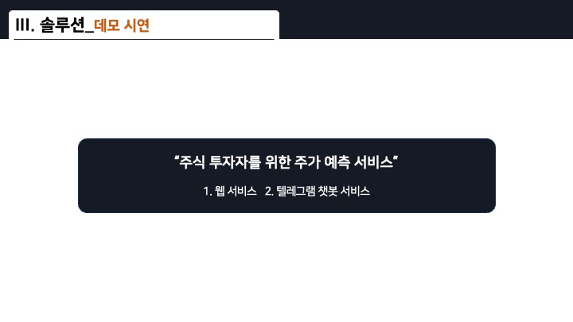


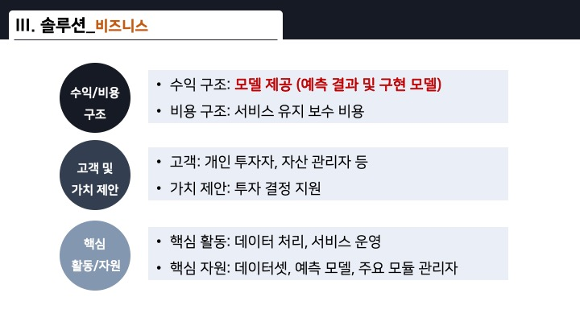
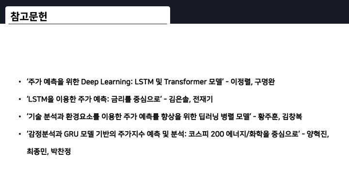
</details>
