# FinSight: 딥러닝 주가 예측 서비스

LSTM, GRU, Transformer, XGBoost를 같은 조건에서 학습하고 튜닝해 RMSE로 비교, 종목별로 고른 모델로 예측을 제공하는 서비스

**포트폴리오**: [suipizza.github.io/projects/finsight.html](https://suipizza.github.io/projects/finsight.html)

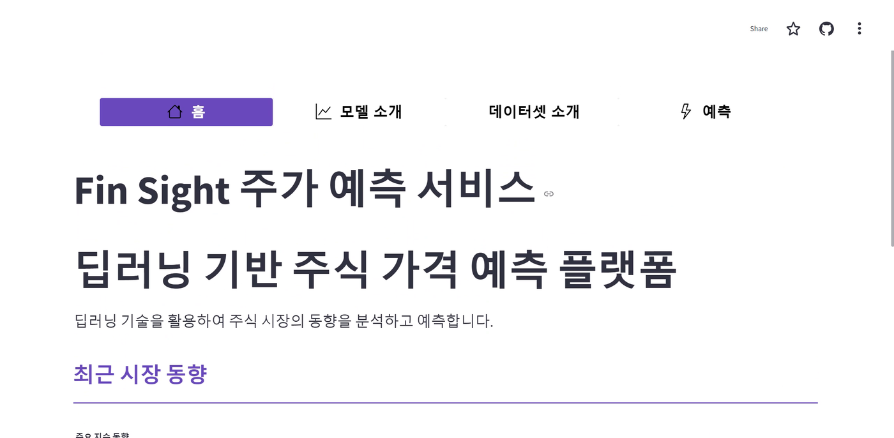

| 기간 | 형태 | 기술 |
|---|---|---|
| 2024.07 – 08 | 3인 팀 (아시아경제 빅데이터 AI솔루션 개발 과정) | Python, TensorFlow(Keras), XGBoost, scikit-learn, yfinance, FRED API, Streamlit, Telegram Bot |

## 문제

- 종목마다 가격을 움직이는 요인이 달라, 하나의 모델로 모든 종목을 예측하기 어렵다고 판단
- 종목별로 잘 맞는 모델과 데이터 조합을 같은 조건에서 비교해 고르는 방식으로 접근

## 실험 설계

- 기술지표(RSI, MACD, 볼린저밴드, 거래량), 외부지표(금리, 달러 인덱스, 장단기 금리차)로 데이터셋 3종 구성
- 모델 4종, 데이터셋 3종, 학습 기간 2종을 종목별로 비교하고 RMSE로 평가 통일
- batch size, units, layers, dropout, epochs 튜닝

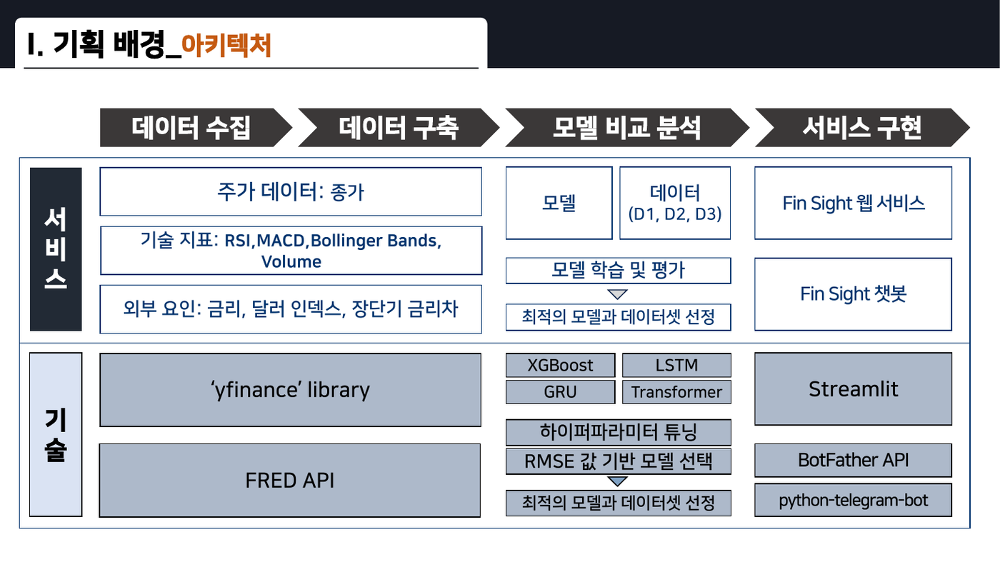

*전체 구조: 데이터 수집, 데이터셋 구성, 모델 비교, 서비스*

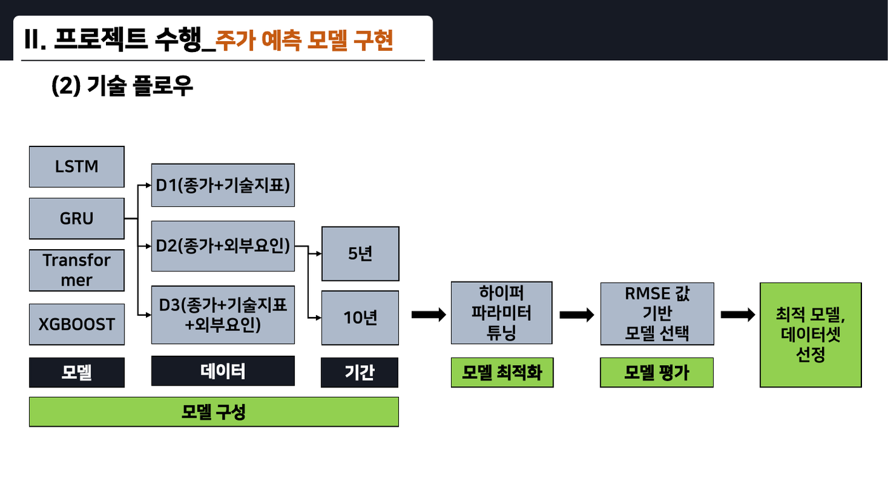

*실험 흐름: 모델 4종 × 데이터셋 3종 × 기간 2종, 튜닝 후 RMSE로 최종 모델 선택*

## 내 역할

- 프로젝트 리딩과 실험 설계
- 모델 구현, 하이퍼파라미터 튜닝, 결과 분석
- 매주 다음 주 예측을 보내는 텔레그램 봇 구현

## 화면

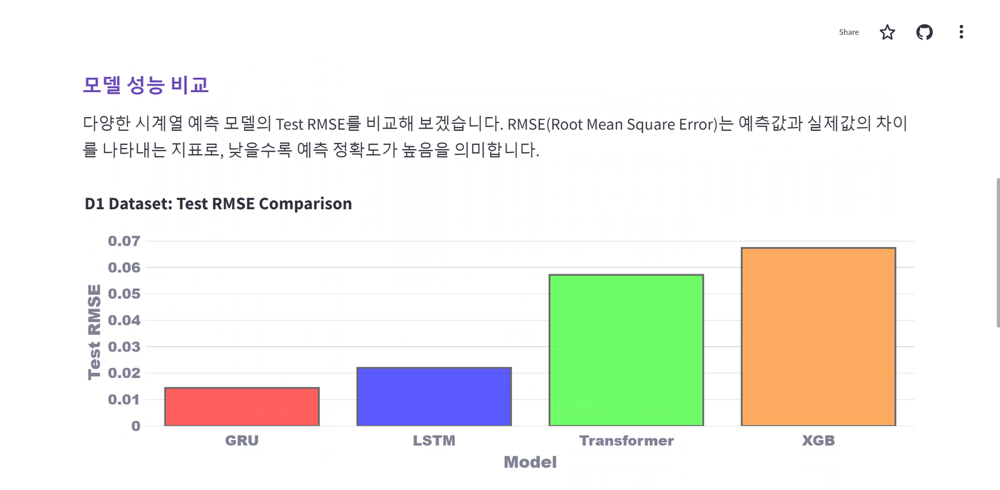

*웹 서비스의 모델 성능 비교 화면 (Streamlit)*

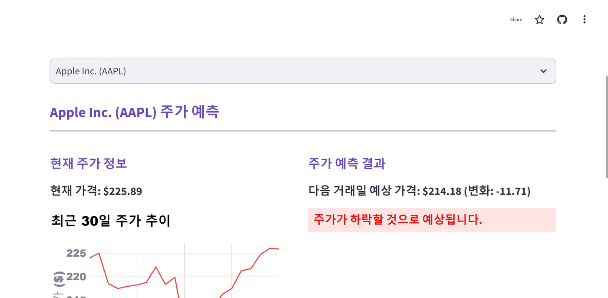

*종목별 예측 화면*

## 배운 점

- 복잡한 모델이 항상 더 좋은 결과를 내지는 않음. 같은 데이터와 지표로 여러 조합을 나란히 비교해야 차이가 어디서 오는지 판단 가능

## 폴더 구조
```text
FinSight
├── 데이터셋/               # 수집 코드, 업종별 주가·기술지표, 외부지표, 예측 결과
├── GRU_하이퍼파라미터튜닝/  # 층·유닛·드롭아웃·배치·에폭 튜닝 결과
├── 모델/                   # 기획서
├── 서비스(챗봇,웹)/         # Streamlit 웹(p2.py), 텔레그램 봇(Bot.py), 시연 영상
└── Doc/                    # 발표 자료
```

## AI 활용

- ChatGPT로 코드 작성과 오류 수정

<details>
<summary><b>발표 자료 보기 (34장)</b></summary>
<br>


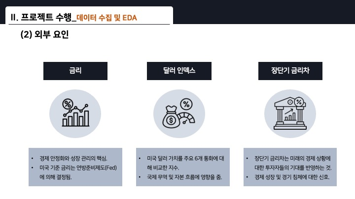
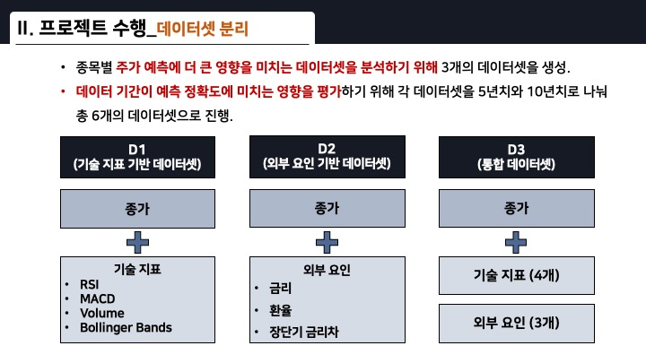


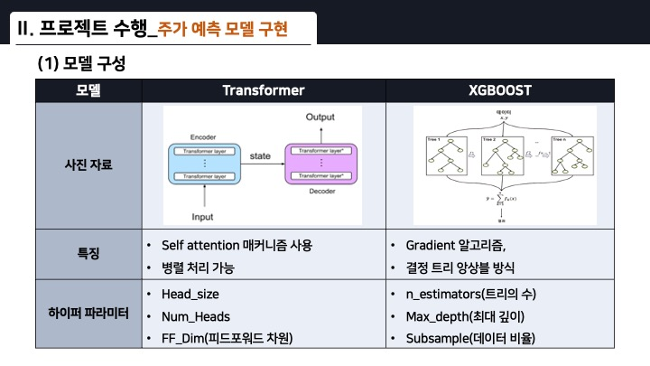


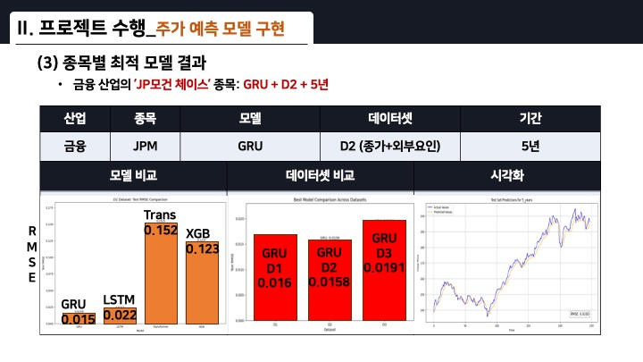


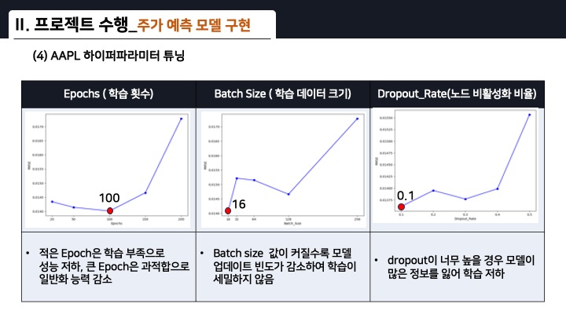
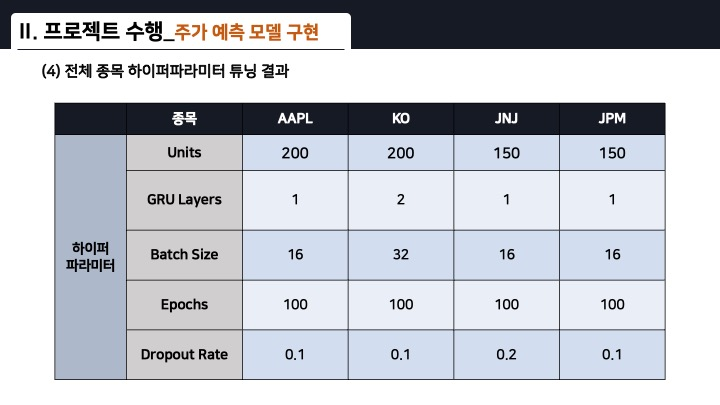
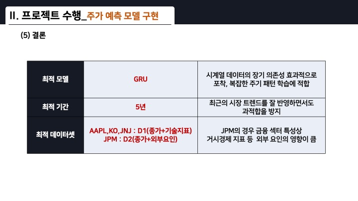


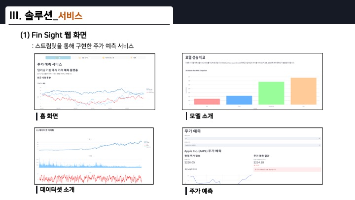


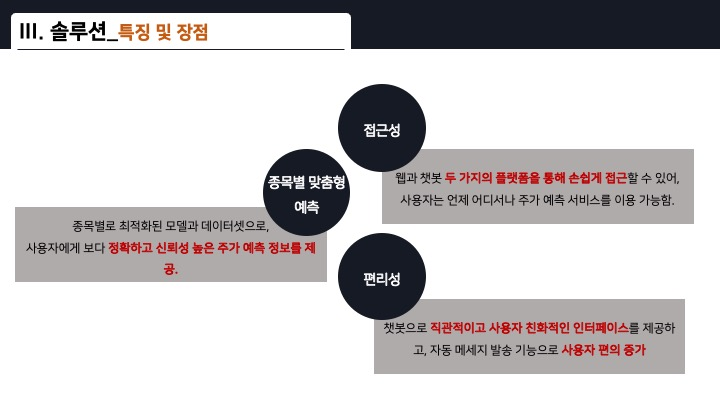
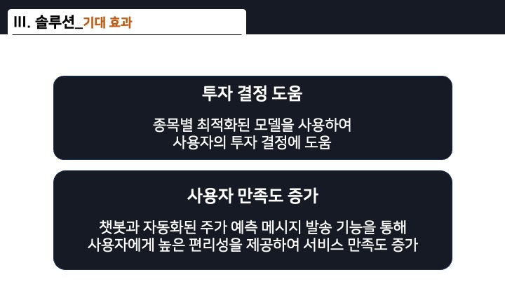


</details>
